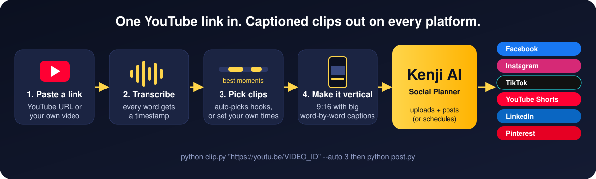
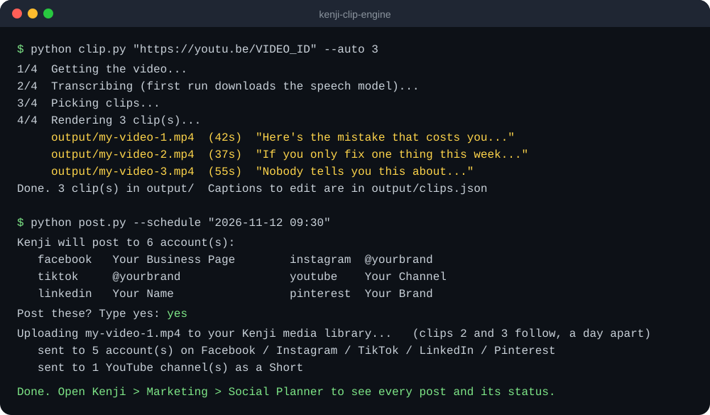
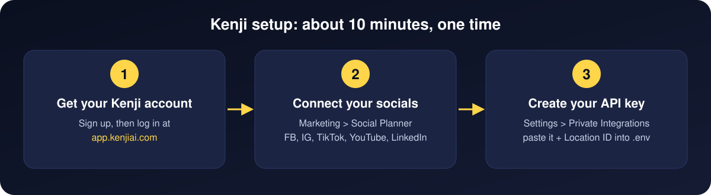
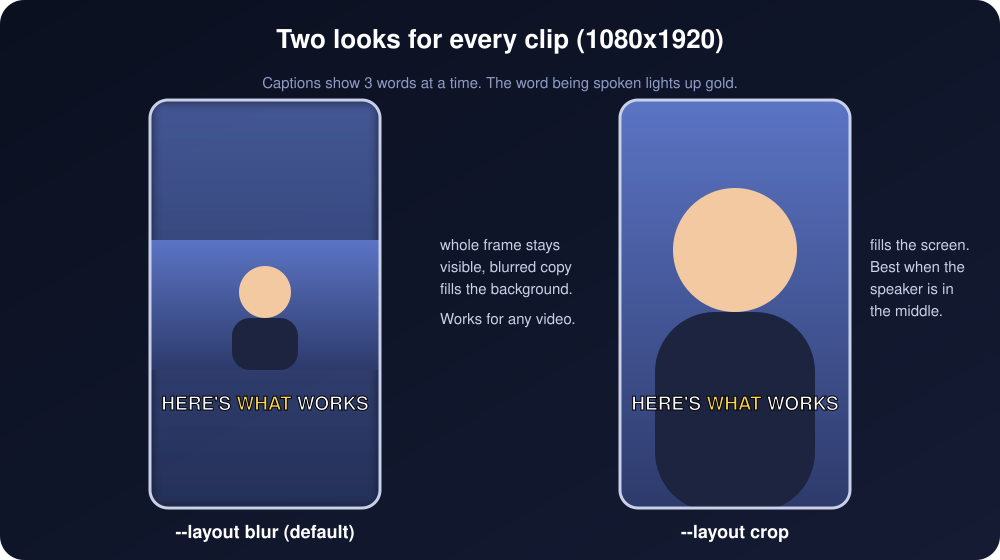
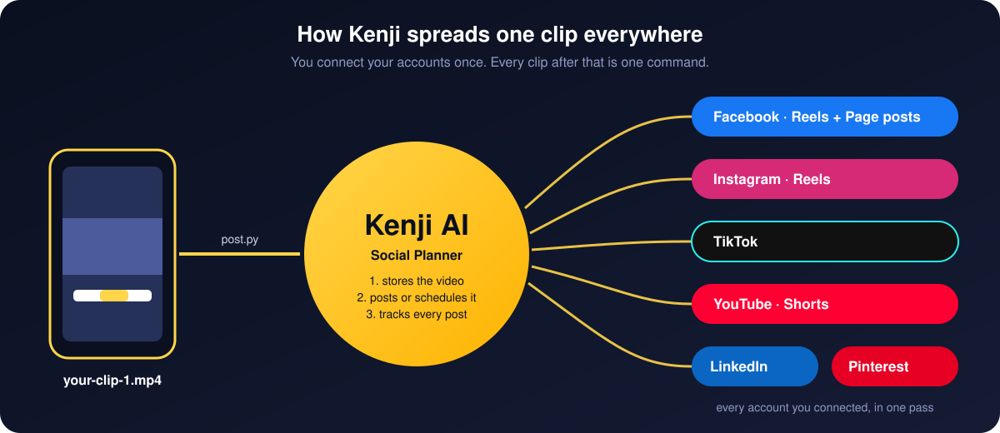
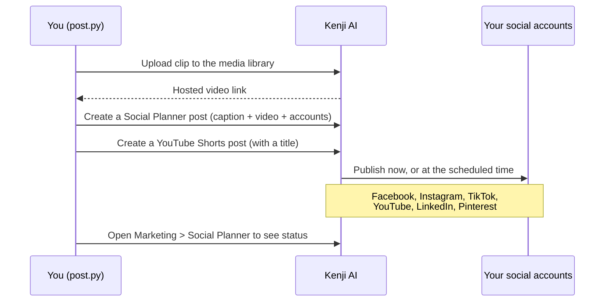
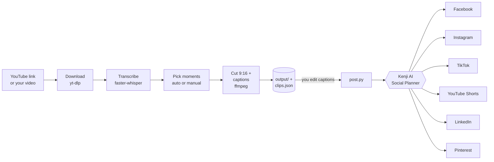

# Kenji Clip Engine

Turn any YouTube video into short vertical clips with captions, then post them to Facebook, Instagram, TikTok, YouTube Shorts, LinkedIn and Pinterest in one go through **[Kenji AI](https://kenjiai.com/?utm_source=github&utm_medium=readme&utm_campaign=kenji-clip-engine)**.



- **Download** a YouTube video (or use your own file).
- **Find the best moments** automatically, or pick the times yourself.
- **Cut 9:16 clips** with big word-by-word captions. The word being spoken lights up gold.
- **Push to Kenji**, which posts or schedules each clip on every account you've connected.

Two commands do all of it:

```bash
python clip.py "https://www.youtube.com/watch?v=VIDEO_ID" --auto 3
python post.py
```



---

## Before you start: only clip videos you have the rights to

Use your own videos, your clients' videos (with their OK), or videos whose owner has given you permission. Reposting someone else's content can get your accounts flagged or taken down, and it breaks YouTube's terms. This tool is built for repurposing **your own** long videos: podcasts, webinars, Zoom calls, YouTube uploads.

---

## Part 1: Set up Kenji AI (one time, about 10 minutes)

Kenji is the part that sends your clips out. You connect your social accounts to Kenji once, and from then on every clip you push lands on all of them.



### Step 1. Get your Kenji account

1. **[Sign up for Kenji AI](https://freedom.kenjiai.com/finishhere?utm_source=github&utm_medium=readme&utm_campaign=kenji-clip-engine)**
2. You'll get your login by email. Log in at **[app.kenjiai.com](https://app.kenjiai.com)**
3. Want help setting it up, or want us to run your content for you? **[Book a call](https://go.mediatraffics.com/leads?utm_source=github&utm_medium=readme&utm_campaign=kenji-clip-engine)**

### Step 2. Connect your social accounts

1. In Kenji, go to **Marketing > Social Planner**.
2. Open the Social Planner settings and connect each account you want clips posted to: Facebook Page, Instagram, TikTok, YouTube, LinkedIn, Pinterest.
3. Log in to each one when it asks, and approve the permissions.

Connect as many as you like. A clip goes to all of them at once.

### Step 3. Create your API key

This key lets the scripts upload clips and create posts in your Kenji account.

1. In Kenji, go to **Settings > Private Integrations**.
2. Click **Create new integration** and name it `Clip Engine`.
3. Turn on these permissions (type them in the search box):

   | Permission | What it's for |
   |---|---|
   | `socialplanner/account.readonly` | See which social accounts you connected |
   | `socialplanner/post.write` | Create and schedule posts |
   | `socialplanner/post.readonly` | Read posts back |
   | `medias.write` | Upload your clips to the media library |
   | `medias.readonly` | Read the media library |
   | `users.readonly` | Find the user the posts go out under |

4. Copy the key. It starts with `pit-`. Kenji only shows it once, so save it now.
5. Find your **Location ID**. It's in your browser's address bar while you're logged in:
   `https://app.kenjiai.com/v2/location/`**`THIS_PART_IS_YOUR_LOCATION_ID`**`/dashboard`

Treat the key like a password. Don't share it or commit it to GitHub. The `.env` file it goes in is already excluded from git.

---

## Part 2: Install the clip engine

You need **Python 3.10+** and **ffmpeg**.

| | Windows | Mac | Linux |
|---|---|---|---|
| Python | [python.org/downloads](https://www.python.org/downloads/) (tick "Add to PATH") | `brew install python` | `sudo apt install python3 python3-pip` |
| ffmpeg | `winget install Gyan.FFmpeg` | `brew install ffmpeg` | `sudo apt install ffmpeg` |
| Deno (YouTube downloads need it) | `winget install DenoLand.Deno` | `brew install deno` | `curl -fsSL https://deno.land/install.sh \| sh` |

Then:

```bash
git clone https://github.com/yousiful/kenji-clip-engine.git
cd kenji-clip-engine
pip install -r requirements.txt
```

Copy `.env.example` to `.env` and paste in your key and Location ID from Part 1:

```
KENJI_API_KEY=pit-xxxxxxxx-xxxx-xxxx-xxxx-xxxxxxxxxxxx
KENJI_LOCATION_ID=your_location_id
```

Check that Kenji is connected. This sends nothing; it only lists the accounts your clips will go to:

```bash
python kenji_check.py
```

```
Connected to Kenji. User for posts: 6362...
6 account(s) ready:
   facebook   Your Business Page
   instagram  @yourbrand
   tiktok     @yourbrand
   youtube    Your Channel
   ...
```

---

## Part 3: Make clips

```bash
# Let it pick the 3 best moments (25 to 60 seconds each)
python clip.py "https://www.youtube.com/watch?v=VIDEO_ID" --auto 3

# Pick the times yourself (minutes:seconds)
python clip.py "https://youtu.be/VIDEO_ID" --clips "1:20-2:05,7:40-8:30"

# Your own video file works too
python clip.py my_webinar.mp4 --auto 5
```

Clips land in `output/`, along with `output/clips.json`, which holds the caption for each clip. **Open `clips.json` and edit the captions before you post.** That's where your hook, call to action and hashtags go.



| Option | What it does |
|---|---|
| `--auto 3` | How many clips to pick automatically |
| `--clips "1:20-2:05,..."` | Your own start and end times instead |
| `--min 25 --max 60` | Shortest and longest auto clip, in seconds |
| `--layout blur` | Full frame in the middle with a blurred background (default, works for any video) |
| `--layout crop` | Fill the whole screen (best when the speaker is centered) |
| `--model small` | Speech model: `tiny`, `base`, `small` (default), `medium`, `large-v3`. Bigger is more accurate and slower |
| `--gpu` | Transcribe on an NVIDIA graphics card |
| `--post` | Push to Kenji as soon as the clips are done |

**How auto-pick works:** it reads the transcript and scores every stretch of 25 to 60 seconds that starts and ends on a full sentence, so a clip never cuts off mid-thought. Openings with hooks ("here's", "why", "mistake", "you"), questions, numbers and fast, energetic speech score higher. The best ones that don't overlap win. Always watch the clips before posting.

---

## Part 4: Post with Kenji



```bash
# See exactly what would post, without sending anything
python post.py --dry-run

# Post everything in output/clips.json now (it asks you to confirm first)
python post.py

# Schedule instead: first clip at this local time, then one per day after it
python post.py --schedule "2026-11-12 09:30"

# Only some platforms
python post.py --only tiktok,instagram,youtube

# Post a single file with your own caption
python post.py output/my-video-1.mp4 --caption "The one change that doubled our leads"
```

By default it posts to Facebook, Instagram, TikTok, YouTube, LinkedIn and Pinterest. Kenji also lists Google Business Profile and Community groups. Add those with `--only` if you want clips there too.

### What happens inside Kenji



1. **Upload.** The clip goes into your Kenji media library, so it's stored with the rest of your marketing.
2. **One post, every account.** Kenji's Social Planner takes a single post and sends it to every account you list. YouTube gets its own post so it's published as a Short with a title.
3. **Now or later.** Without `--schedule` it goes out right away. With it, Kenji holds each post and publishes it at that time.
4. **Track it.** Every post, its status and any errors show up under **Marketing > Social Planner** in Kenji.

---

## The full flow



## What's in here

| File | What it does |
|---|---|
| `clip.py` | The main command: YouTube link or file in, captioned vertical clips out |
| `post.py` | Sends clips to Kenji, now or scheduled |
| `kenji_check.py` | Checks your Kenji key and lists your connected accounts |
| `clipper/download.py` | Downloads the video with yt-dlp |
| `clipper/transcribe.py` | Word-level transcript with faster-whisper (cached, so re-runs are instant) |
| `clipper/pick.py` | Auto-picks the best moments, or reads your times |
| `clipper/render.py` | Cuts the clip, makes it 1080x1920 and burns in the captions with ffmpeg |
| `clipper/kenji.py` | Kenji API: list accounts, upload media, create posts |

## Fixing common problems

| Problem | Fix |
|---|---|
| `Kenji list accounts failed: 401` | The key is wrong, was deleted, or is missing a permission from Step 3. Make a new one. |
| `No connected accounts to post to` | Connect your socials in Kenji (Step 2), then run `python kenji_check.py`. |
| YouTube download fails or warns about JavaScript | Install Deno (Part 2), then update the downloader: `pip install -U yt-dlp` |
| `ffmpeg` not found | Install ffmpeg (Part 2) and open a new terminal. |
| Captions misspell names | Use a bigger model: `--model medium` |
| A post shows an error in Social Planner | Usually an expired social login. Reconnect that account in Kenji. |

## Want the fancier edits?

This repo keeps things simple: clean cuts and bold captions. For animated cue cards, zooms, sound effects and music, see our full editing pipeline: **[reel-editing-toolkit](https://github.com/yousiful/reel-editing-toolkit)**.

## Want us to do it for you?

We run content and ads for businesses on Kenji. **[Book a call](https://go.mediatraffics.com/leads?utm_source=github&utm_medium=readme&utm_campaign=kenji-clip-engine)** or start at **[kenjiai.com](https://kenjiai.com/?utm_source=github&utm_medium=readme&utm_campaign=kenji-clip-engine)**.

## Feedback and bugs

Something broke, or you want a feature? **[Open an issue](https://github.com/yousiful/kenji-clip-engine/issues/new/choose)**. We read every one and fix what we can. If this saved you time, a star helps other people find it.

MIT License.
